# OGIAS — Manuel de l'utilisateur

OGIAS est un logiciel d'ingénierie en automatisme, télégestion et supervision. À partir de l'inventaire des
équipements d'un ouvrage (réservoir, station de pompage…), il établit la liste des entrées et sorties, propose le
matériel automate, attribue les adresses des variables, contrôle la cohérence de l'ensemble et produit les livrables :
fichiers pour l'automate et la supervision, documents d'études, cahiers d'essais.

Les captures de ce manuel sont prises sur un ouvrage **fictif** (lieu XTST). Ce manuel décrit la version indiquée
dans Aide › À propos ; les évolutions sont consignées dans `CHANGELOG.md`.

## 1. Démarrer

Double-cliquez sur `OGIAS.bat`. OGIAS s'ouvre sur **Mes ouvrages**.

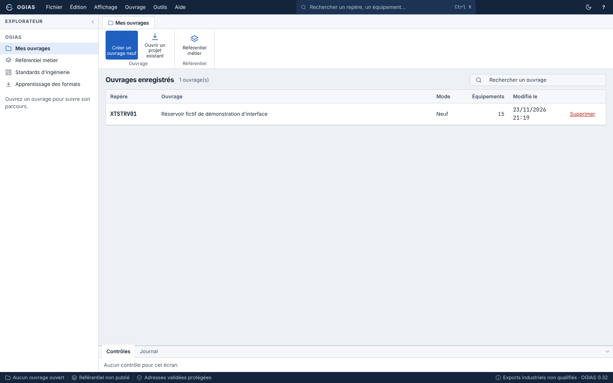

- **Nouvel ouvrage neuf** (menu Fichier) : un ouvrage à concevoir. Choisissez le standard d'ingénierie du client,
  puis renseignez la fiche : lieu, type et numéro d'ouvrage, libellé, automate, révision.
- **Reprendre un projet existant** : un ouvrage dont le programme automate existe déjà. Ses noms et adresses d'origine
  sont conservés ; OGIAS ne les recalcule jamais.
- Cliquez un ouvrage de la liste pour l'ouvrir.

Si un ouvrage est déjà ouvert par un collègue, OGIAS l'indique (poste, utilisateur, heure). Vous pouvez le reprendre
après confirmation : son poste ne pourra plus enregistrer, prévenez-le.

## 2. L'écran

- **Menus** (Fichier, Édition, Affichage, Ouvrage, Outils, Aide) et **ruban** des commandes de l'écran courant.
- **Explorateur** à gauche : vos ouvrages, l'ouvrage ouvert et les **cinq étapes** du parcours, avec leur état.
- **Panneau de sortie** en bas : les contrôles (« Pour passer à l'étape suivante » et « À vérifier ») et le journal
  des messages de la session. Chaque point se clique pour aller à l'endroit à corriger.
- Raccourcis utiles : **Ctrl K** rechercher, **Ctrl Z** / **Ctrl Y** annuler / rétablir, **F1** aide,
  **Ctrl /** liste des raccourcis.

Le **tableau de bord** résume l'ouvrage : avancement des étapes, répartition des E/S, points à traiter.

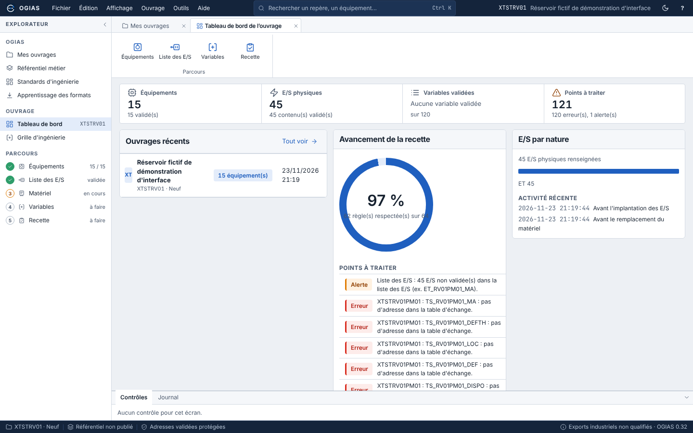

## 3. Le parcours en cinq étapes

### Étape 1 — Équipements

Ajoutez les équipements de l'ouvrage (pompes, vannes, mesures…) à partir des modèles du référentiel, rangez-les en
unités fonctionnelles, puis validez le paramétrage de chacun (options, signaux retenus).

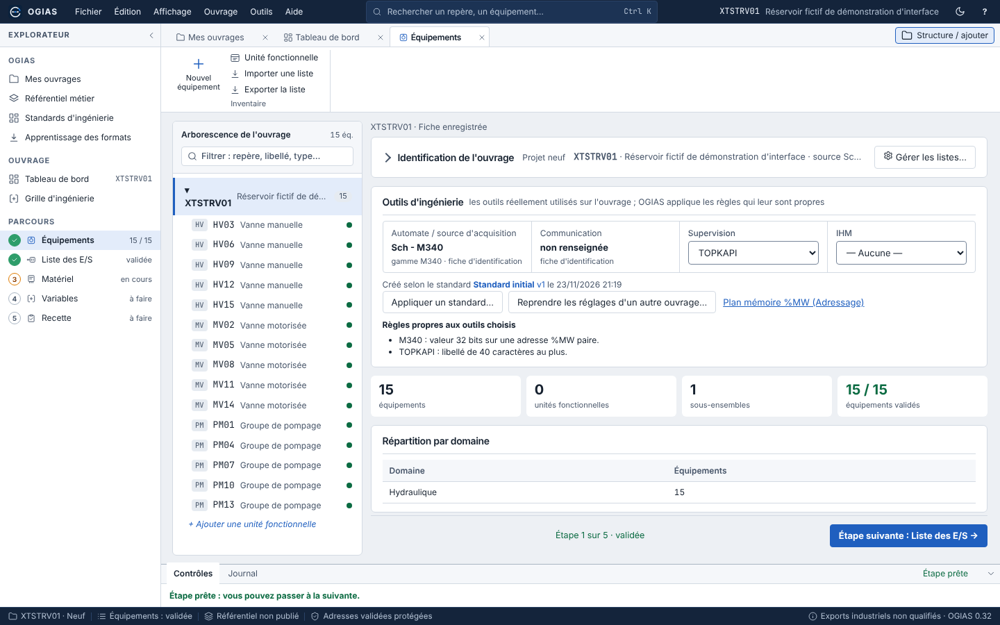

- **Dupliquer** (ruban de l'équipement) crée une copie au numéro libre suivant, sans aucune adresse ni voie.
- Les informations proposées par une règle se retiennent ou s'écartent (motif obligatoire) : rien n'est ajouté sans
  vous.

### Étape 2 — Liste des E/S

OGIAS déduit les entrées et sorties physiques de chaque équipement. Vérifiez leur nature, leur sens et leur
désignation, puis validez leur contenu.

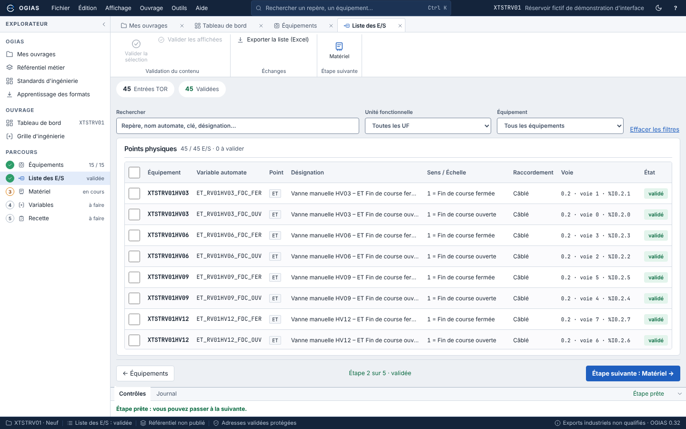

### Étape 3 — Matériel

OGIAS propose les racks et les cartes d'E/S à partir des E/S validées, avec une réserve par carte (20 % au moins) ;
les équipements secourus sont placés sur des cartes distinctes. Implantez ensuite les E/S sur les voies, vérifiez,
puis validez le matériel.

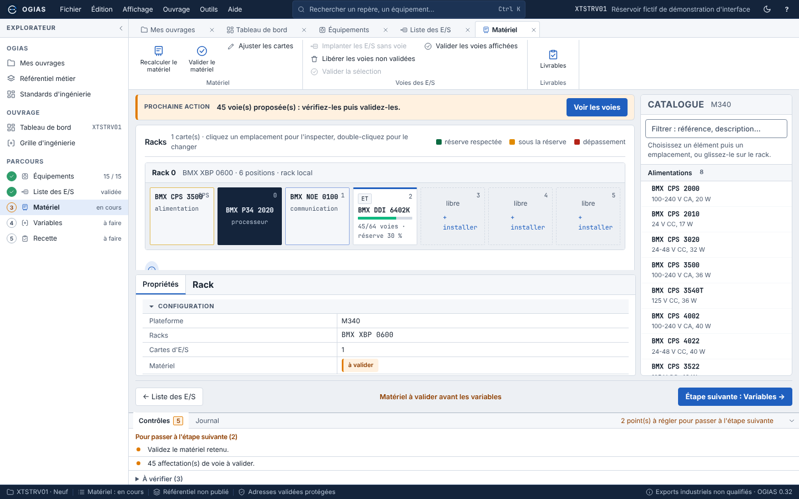

- Gammes livrées : Schneider Modicon M340, M580, Advantys STB, SOFREL S4W, Siemens S7-1500.
- Pour un autre automate, la gamme se déclare une fois (§ 5) ; OGIAS la calcule alors de la même façon.

### Étape 4 — Variables

OGIAS propose l'adresse automate de chaque variable d'échange selon le plan d'adressage du standard, et le registre de
télétransmission. Validez les propositions ; une adresse validée est protégée.

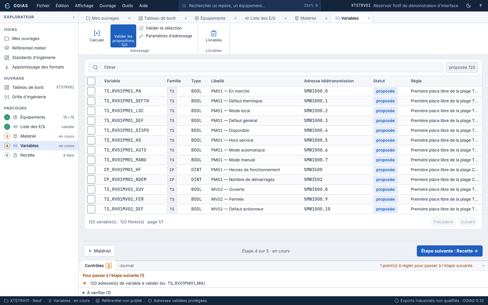

### Étape 5 — Recette et livrables

La recette consolide tous les contrôles, groupés par règle, chacun avec sa correction. Les livrables se téléchargent
ici.

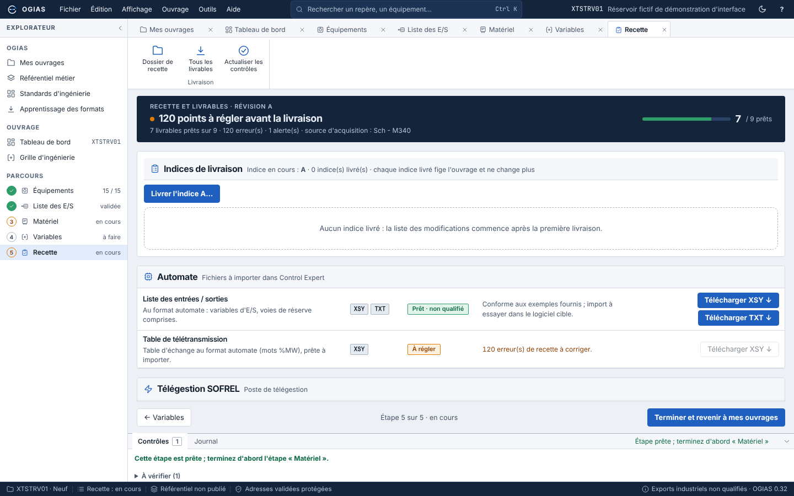

- **Tous les livrables** : un zip rangé par destination (automate, télégestion, supervision, documents, essais,
  modèles) avec un journal de ce qui a été produit et de ce qui ne l'a pas été, et pourquoi.
- **Dossier de recette** : sommaire imprimable en PDF et pièces du dossier.
- **Indices de livraison** : livrez l'indice courant (A, B…) ; OGIAS fige l'ouvrage à cet indice et liste ensuite
  les modifications depuis le dernier indice livré, ou entre deux indices, en Excel.

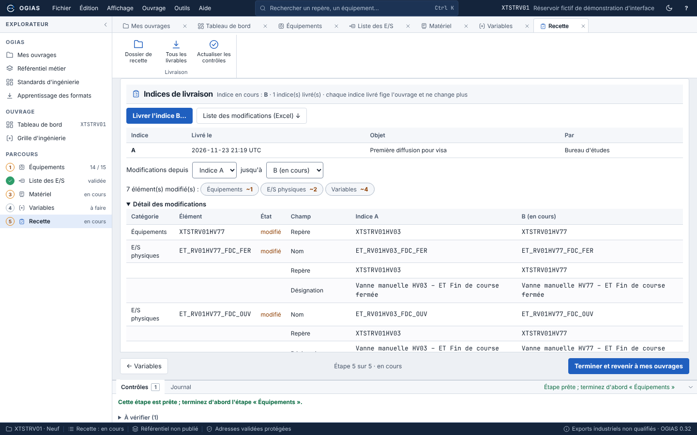

Un export « non qualifié » doit être importé une fois dans le logiciel cible avant d'être utilisé en service.

## 4. Votre travail est protégé

- **Enregistrement automatique** après chaque modification ; la version précédente est gardée.
- **Annuler / rétablir** : Ctrl Z / Ctrl Y ou menu Édition, jusqu'à 30 modifications.
- **Copies de sauvegarde** : avant chaque opération lourde (adressage, implantation, matériel, import…), OGIAS copie
  l'ouvrage. Fichier › Copies de sauvegarde pour les consulter et en restaurer une.
- **Un seul poste à la fois** sur un même ouvrage (verrou, § 1).

## 5. Adapter OGIAS à chaque client

Menu Outils › **Standards d'ingénierie**.

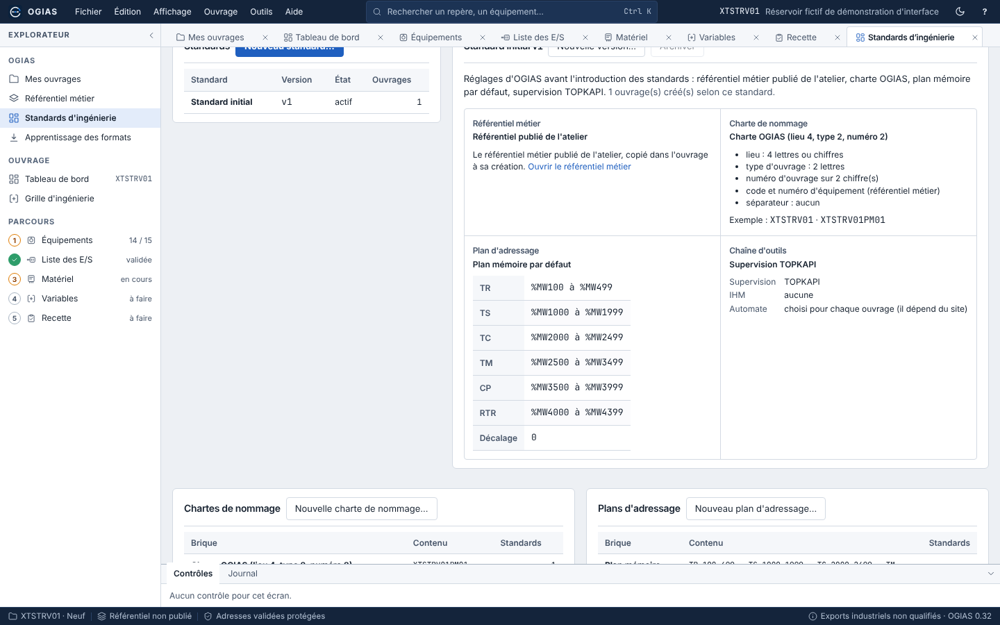

- **Standards** : la charte de nommage, le plan d'adressage et la chaîne d'outils (supervision, IHM) d'un client.
  Choisi à la création d'un ouvrage, un standard y est copié ; une nouvelle version ne modifie jamais un ouvrage
  déjà créé.
- **Gammes de matériel** : pour un automate hors des gammes livrées, déclarez sa gamme une fois (texte qui la reconnaît
  dans la fiche de l'ouvrage, racks, cartes). Les listes se collent depuis Excel.
- **Formats d'export appris** : voir l'onglet **Apprentissage des formats** ci-dessous.
- **Modèles de livrables** : un fichier de votre outil où les valeurs sont remplacées par des variables `<#…#>` ;
  « Créer depuis un export » le prépare à partir de l'export d'un seul équipement.

### Apprentissage des formats

Menu Outils › **Apprentissage des formats** (ou l'explorateur). OGIAS n'est lié à aucun constructeur : il apprend le
format de chaque outil à partir d'un fichier que vous exportez. Trois fichiers seulement sont concernés : la liste des
E/S physiques de chaque automate, la télétransmission de chaque supervision et l'IHM.

1. **Exportez**, depuis le logiciel du constructeur (Control Expert, TIA Portal, TOPKAPI…), la table de variables d'un
   projet quelconque.
2. **Importez** le fichier dans OGIAS (CSV, TXT ou classeur Excel) avec « Importer un fichier et apprendre son
   format… ». Rien n'est enregistré à ce stade.
3. **Dites de quel format il s'agit** : nature du fichier, logiciel cible, contenu de chaque colonne, forme des
   adresses. OGIAS vérifie sur l'ouvrage ouvert qu'il relit exactement son propre fichier.
4. **Qualifiez** : après un premier import réel réussi dans l'outil, confirmez-le dans la fiche du format. Le format
   devient **qualifié** et chaque export suivant est contrôlé automatiquement.

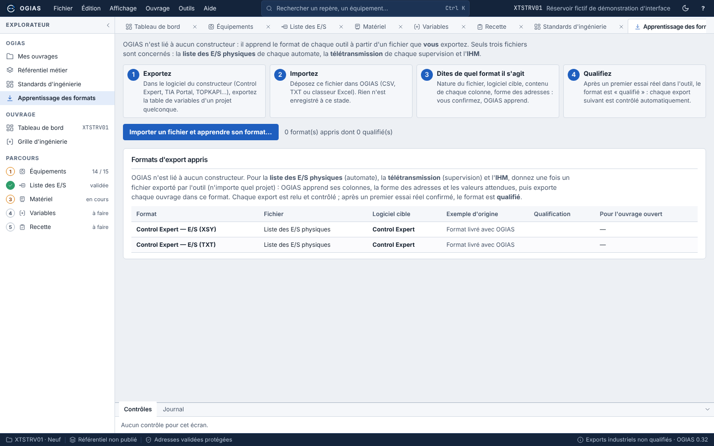

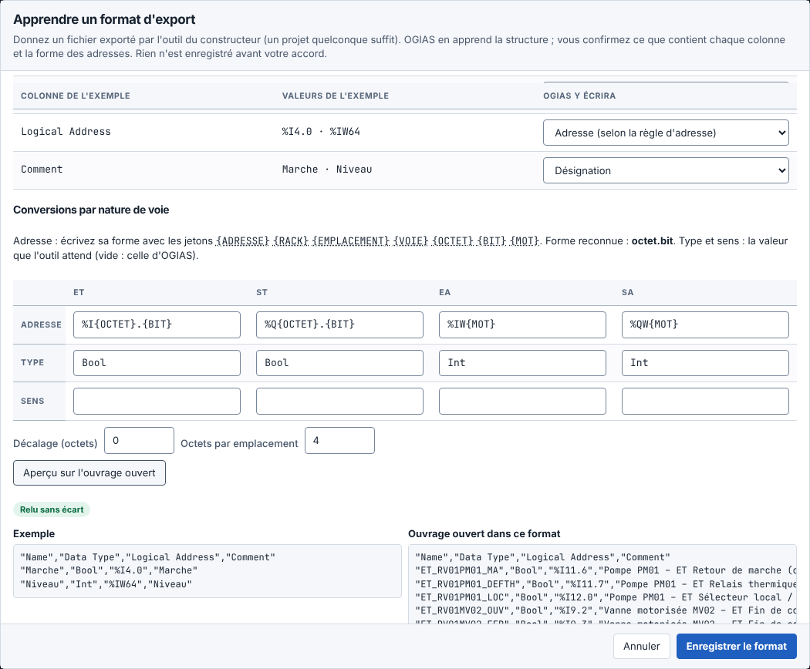

### Rapprochement d'un projet existant

Pour un ouvrage en mode **Existant**, Ouvrage › **Rapprochement** relit le programme importé. OGIAS déclare d'abord les
équipements détectés dans les noms des variables (vous cochez ceux qui existent), construit une ligne par information
à télétransmettre, puis **propose** la variable du programme qui la porte. Chaque proposition affiche son niveau de
confiance (« élevée » ou « à rapprocher manuellement ») et sa raison. Rien n'est appliqué sans votre geste : *Confirmer*
une ligne, ou *Confirmer en lot* pour les seules confiances élevées (le lot est tracé et peut être annulé).
Chaque ligne a aussi son **accès** (adresse ou tag d'acquisition, protocole, « vérifié » une fois essayé dans l'outil de
supervision) et peut être déclarée **non accessible** avec un motif obligatoire. Le bandeau « Avant de valider l'ouvrage »
liste ce qui reste à traiter.

### Ouvrage d'exemple

Un ouvrage entièrement fictif (lieu XTST, réservoir et sept équipements) est livré à part, dans le dossier `exemples`
de la version portable : `OGIAS_exemple_XTSTRV01.ouvrage.json`. Copiez-le dans le dossier des ouvrages pour l'essayer ;
l'installation, elle, ne contient aucune donnée de démonstration.

## 6. Référentiel métier

Menu Outils › **Référentiel métier** : types d'équipements, modèles, lexique, dictionnaire des codes. On le modifie
dans un brouillon, contrôlé puis publié comme nouvelle révision. Un ouvrage garde la révision avec laquelle il a été
conçu tant qu'on ne lui fait pas adopter la nouvelle, après aperçu des différences et confirmation.

## 7. Aide

- **F1** : aide d'OGIAS.
- **Aide › Raccourcis clavier**.
- **Aide › Journal technique** : à joindre à une demande d'assistance.
- **Aide › À propos** : version et licences.
